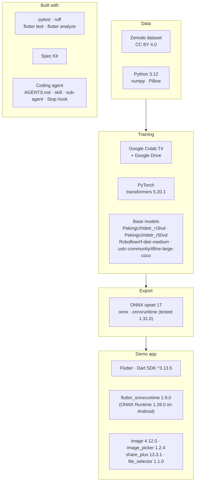
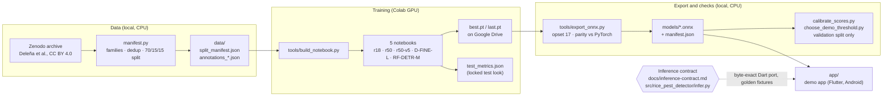
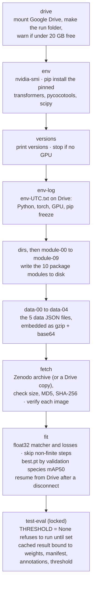
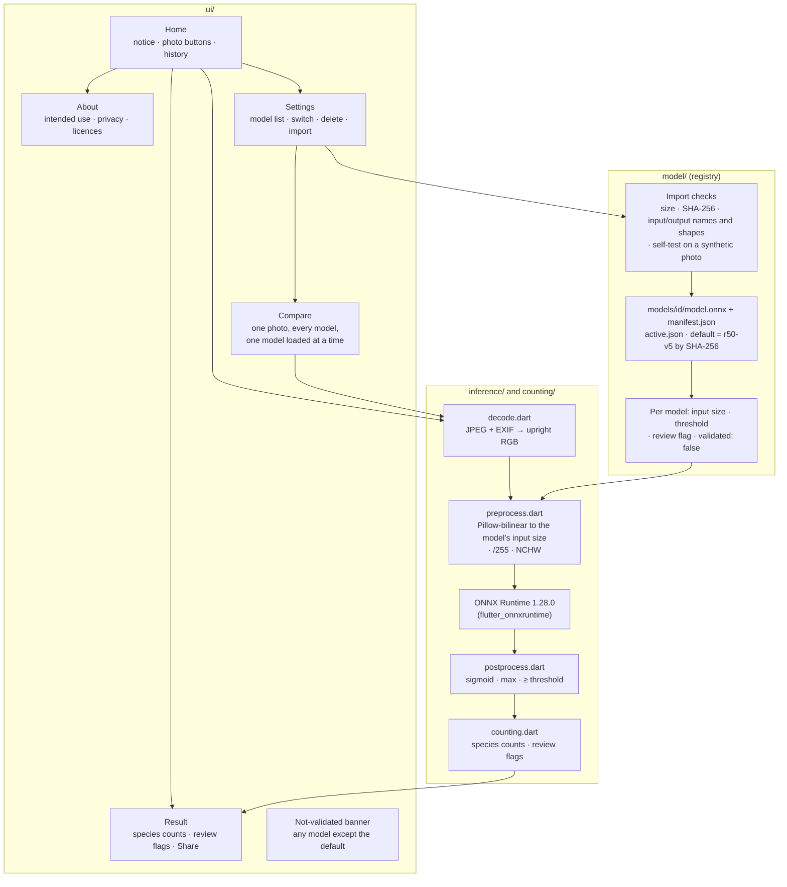

# Rice-Pest Detector

[](https://github.com/kurtvalcorza/rice-pest-detector/actions/workflows/tests.yml)
[](https://www.kaggle.com/models/kurtvalcorza/rice-pest-detector)

A CPU-friendly object detector, in development, for counting **rice black bug** (*Scotinophara coarctata*) and **white stemborer** (*Scirpophaga innotata*) in light-trap photos. It is trained on an open light-trap image dataset (Deleña et al.), and it comes with a demonstration Android app that runs the model on the phone. The trained weights are published on [Kaggle](https://www.kaggle.com/models/kurtvalcorza/rice-pest-detector) as ONNX files, for teaching and demonstration only.

> **⚠️ Notice.** For research, training and evaluation only. Not validated for production,
> clinical, diagnostic or safety-critical use, and not a field pest-surveillance or pest-alert system.
> Running the training notebook downloads third-party model weights and datasets under their own
> licenses (see [docs/model-card.md](docs/model-card.md) and [data/README.md](data/README.md)) and uses compute on your own Colab or Kaggle account.
> The Android app's counts are experimental estimates: they are not agronomic advice, must not be the
> basis for any pest-management or spraying decision, and should be reviewed by an agricultural
> technician. Installing the app or a model on a device is at your own risk.
> Results here are tutorial evidence, not benchmarks. Everything is provided "as is", without
> warranty of any kind. To the maximum extent permitted by law, the maintainers accept no liability for its use.
>
> This is a teaching and demonstration project, made for the *Coding with AI Agents* workshop. It is
> not an official tool, product or service of any organisation or government agency, and no
> organisation endorses it. The Android app demonstrates running a model on a phone: it is **not made
> for farmers** and has not been validated in the field.

**Who it is for.** Participants in the *Coding with AI Agents* workshop, and anyone learning to build software with AI coding agents. The repository is a worked example of the whole path, from a written spec to a tested, documented result:

- **Specs.** [Spec Kit](https://github.com/github/spec-kit) specs for the project: a [constitution](.specify/memory/constitution.md) and one folder per feature in [specs/](specs/): the model (001), the phone app (002) and a planned desktop app (003), each with its spec, plan and task list. A self-paced exercise walks you through Spec Kit's [quickstart](https://github.github.io/spec-kit/quickstart.html) on the desktop app ([docs/workshop-setup.md](docs/workshop-setup.md), Module 3, "Going further").
- **Agent configuration.** The `AGENTS.md` briefing, a skill, a read-only sub-agent and a Stop hook that keeps the agent working until the tests pass (`.claude/`).
- **A model, trained and judged by rules fixed in advance.** Colab and Kaggle training notebooks, evaluation, calibration and ONNX export, with every result and its provenance in [docs/evaluation-record.md](docs/evaluation-record.md).
- **A demonstration app.** A Flutter Android app (`app/`) built milestone by milestone, test-first, that counts both species on a trap photo and can switch between and compare models. It shows how to put a model behind an app; it is not a tool for farmers and is not validated for any pest-management decision.
- **The story in slides.** The session deck and case studies on how the model was trained and the app was built ([docs/presentations/](docs/presentations/)).

> **Status (2026-10-18): teaching demo.** The current model, r50-v5, meets the three model quality gates on held-out test photos (count accuracy 0.849). Its ONNX weights are published on [Kaggle](https://www.kaggle.com/models/kurtvalcorza/rice-pest-detector) as a teaching demo; it has not been validated in the field and is not for farmers.
> See [Models](#models) and [Status and release gates](#status-and-release-gates).

---

## Setup

- **What to install, by task**, with the commands for Windows (winget), macOS (Homebrew) and Linux (Ubuntu): [docs/setup.md](docs/setup.md).
- **Coding with AI Agents**, the 2-hour session or its exercises on your own: [docs/workshop-setup.md](docs/workshop-setup.md). It needs Git and this repository, an AI coding agent you are allowed to use (set up safely), an empty practice folder, and `uv` with Spec Kit, and it has a prompt that lets your agent check and install them, asking before each command.

On a work or school laptop, installs may be blocked: ask your IT team first, or pair with someone for the exercises.

---

## Contents

- [Models](#models)
- [Dataset](#dataset)
- [Architecture](#architecture)
- [Status and release gates](#status-and-release-gates)
- [Quick start](#quick-start)
- [Data pipeline](#data-pipeline)
- [Training on Colab](#training-on-colab)
- [Training on Kaggle](#training-on-kaggle)
- [Evaluation](#evaluation)
- [Export to ONNX and parity](#export-to-onnx-and-parity)
- [Choosing a demo threshold](#choosing-a-demo-threshold)
- [Inference contract](#inference-contract)
- [Demo app (Android)](#demo-app-android)
- [Testing](#testing)
- [Repository layout](#repository-layout)
- [Agent configuration (examples)](#agent-configuration-examples)
- [Licences and attribution](#licences-and-attribution)
- [AI Use Disclosure](#ai-use-disclosure)
- [Further documentation](#further-documentation)
- [Out of scope](#out-of-scope)

---

## Models

Three models were trained in the second round ("wave 2"), all on Colab T4s for 40 epochs with the same split and recipe. r50-v5 is the demo model; the other two are kept for comparison.

Each was fine-tuned from a COCO-pretrained base model on Hugging Face (Apache-2.0). Each model has two badges: Hugging Face opens the base model it was fine-tuned from, at the exact revision used; Kaggle opens the fine-tuned ONNX weights published from this project.

**Trained weights.** All three fine-tuned models are published on Kaggle as ONNX files (Apache-2.0, dataset credited), one variation each: [r50-v5](https://www.kaggle.com/models/kurtvalcorza/rice-pest-detector/Onnx/r50-v5), [rf-detr-m](https://www.kaggle.com/models/kurtvalcorza/rice-pest-detector/Onnx/rf-detr-m) and [d-fine-l](https://www.kaggle.com/models/kurtvalcorza/rice-pest-detector/Onnx/d-fine-l). Each variation holds `model.onnx`, `manifest.json` and its model card (`README.md`). They are a teaching demo: not validated in the field, not an official tool and not for farmers.

- **r50-v5: RT-DETR, ResNet-50-vd backbone.** [](https://huggingface.co/PekingU/rtdetr_r50vd/tree/df939e661d8c52e80608d1ec566561aabd25a4e7) [](https://www.kaggle.com/models/kurtvalcorza/rice-pest-detector/Onnx/r50-v5)
  RT-DETR (Real-Time DEtection TRansformer) is an end-to-end transformer detector that needs no non-maximum suppression; this variant pairs it with a ResNet-50-vd convolutional backbone. It is the demo model. Paper: [DETRs Beat YOLOs on Real-time Object Detection](https://arxiv.org/abs/2304.08069).
- **RF-DETR-M: RF-DETR, medium.** [](https://huggingface.co/Roboflow/rf-detr-medium/tree/1b5b672408f86dd38e05dd3cf3f2e0834e545a59) [](https://www.kaggle.com/models/kurtvalcorza/rice-pest-detector/Onnx/rf-detr-m)
  A real-time detection transformer from Roboflow with a DINOv2-style vision-transformer backbone (windowed attention) and a multi-scale deformable decoder; its sizes were chosen by neural architecture search. Runs at 576×576. Paper: [RF-DETR: Neural Architecture Search for Real-Time Detection Transformers](https://arxiv.org/abs/2511.09554).
- **D-FINE-L: D-FINE, large.** [](https://huggingface.co/ustc-community/dfine-large-coco/tree/aa8f8211545e4cff5adf52ea512f9ac74a9824ec) [](https://www.kaggle.com/models/kurtvalcorza/rice-pest-detector/Onnx/d-fine-l)
  A real-time DETR that predicts each box edge as a probability distribution and refines it layer by layer (Fine-grained Distribution Refinement), with self-distillation between layers. The COCO-only weights were used, not the Objects365 variant. Paper: [D-FINE: Redefine Regression Task in DETRs as Fine-grained Distribution Refinement](https://arxiv.org/abs/2410.13842).

| | **r50-v5** (demo model) | RF-DETR-M | D-FINE-L |
| :-- | :-- | :-- | :-- |
| Architecture, base model | RT-DETR (ResNet-50), `PekingU/rtdetr_r50vd` | RF-DETR (medium), `Roboflow/rf-detr-medium` | D-FINE (large), `ustc-community/dfine-large-coco` |
| Input size | 640×640 | 576×576 | 640×640 |
| Counting threshold | 0.48 | 0.48 | 0.50 |
| Count accuracy, validation (out-of-fold) | 0.834 | 0.846 | 0.822 |
| Count accuracy, test | **0.849** (the pre-registered test look) | 0.806 (post-hoc) | 0.833 (post-hoc) |
| Species mAP50, test | 0.943 | 0.944 | 0.946 |
| White stemborer error, trays with 30+ insects, test (23 images) | 4.87 | 4.57 | 5.26 |
| ONNX size | 171.7 MB | 122.0 MB | 125.2 MB |
| CPU time per photo (median of 10) | 1.14 s | 0.33 s | 0.14 s |

**How r50-v5 was chosen.** Four rules (A–D, see [Evaluation](#evaluation)) were fixed before any wave-2 result. They compared the models on validation only: out-of-fold count accuracy, plus a paired bootstrap on the 18 crowded white-stemborer trays. r50-v5 met rule A against the previous demo model; neither challenger met rule B against r50-v5. Only then was the test split used, once, for r50-v5. The two challengers' test results were computed afterwards at the owner's request and are for comparison only: they played no part in the choice.

**Why the earlier runs scored low.** Runs r18-1 and r50-1 were trained on transformers 4.57.6, whose RT-DETR main loss included the 100 denoising queries; transformers 5.18 fixed it. With the same recipe on 5.20.1, the top validation score rose from 0.31 (r50-1) to 0.94 (r50-v5).

| Earlier run (history only) | Model | Result |
| :-- | :-- | :-- |
| r18-1 | RT-DETR (ResNet-18), transformers 4.57.6 [](https://huggingface.co/PekingU/rtdetr_r18vd/tree/ac77a11ff0170a41b771c03264987f8ce2b0d753) | Test species mAP50 0.835; count accuracy 0.456 at 0.50, equal to counting nothing |
| r50-1 | RT-DETR (ResNet-50), transformers 4.57.6 [](https://huggingface.co/PekingU/rtdetr_r50vd/tree/df939e661d8c52e80608d1ec566561aabd25a4e7) | Validation count accuracy 0.751 (out-of-fold, at 0.04); no test look |

**In the app.** Each model has a manifest in `models/*.manifest.json` (architecture, input size, threshold, review flag, SHA-256, validation figures). The app can switch between installed models and compare them on one photo; see [Demo app (Android)](#demo-app-android). The `.onnx` files are not in this repository; they are published on [Kaggle](https://www.kaggle.com/models/kurtvalcorza/rice-pest-detector).

Full figures and provenance: [docs/evaluation-record.md](docs/evaluation-record.md) ("Wave 2" and "Test look") and [docs/model-card.md](docs/model-card.md).

---

## Dataset

**Source.** Deleña, R.; Balleras, G.; Dequiña, B. J.; Jumawan, R.; Flores, C. *Annotated light-trap rice pest image dataset with detector-derived region-of-interest crops for species-sex recognition of rice black bug and white stemborer.* Version 1. Zenodo. [doi:10.5281/zenodo.20066074](https://doi.org/10.5281/zenodo.20066074). Licence: [CC BY 4.0](https://creativecommons.org/licenses/by/4.0/).

**What it contains.** Photos of light-trap trays with box labels for rice black bug and white stemborer, each split into female and male: four classes, `RBB_FEMALE`, `RBB_MALE`, `WSB_FEMALE` and `WSB_MALE`. Trays hold up to 106 insects.

**Our split** (`data/split_manifest.json` and `data/annotations_*.json`):

| | Train | Validation | Test | Total |
| :-- | --: | --: | --: | --: |
| Images | 4,948 | 253 | 252 | 5,453 |
| Families | 1,179 | 253 | 252 | 1,684 |
| Boxes | 64,814 | 2,913 | 3,320 | 71,047 |
| RBB female | 15,886 | 739 | 840 | 17,465 |
| RBB male | 11,176 | 467 | 580 | 12,223 |
| WSB female | 22,830 | 957 | 1,145 | 24,932 |
| WSB male | 14,922 | 750 | 755 | 16,427 |

A family is an original photo and its augmented variants. Families stay together in one split. Train keeps every variant; validation and test keep one image per family.

**Changes made to the published dataset** (full list in [data/README.md](data/README.md)):

- Re-split 70/15/15 by family, with a fixed seed (`20261013`), instead of the published train/valid/test split.
- Near-duplicate families merged into one group before splitting, so that close copies cannot sit on both sides.
- 652 label files with polygon rows converted to bounding boxes.
- Families with bad labels excluded and listed in `data/exclusions.json` (one family, for a missing label).
- YOLO labels converted to COCO JSON.

**Caveats.** The images were pre-stretched to 640×640 before release. Capture date, location and trap fields are blank. The annotations are not documented as human-verified. The published split had one family crossing train and test. There are no pest-free images.

**No images are redistributed.** The training notebooks download the archive from Zenodo and check every image against the manifest.

---

## Architecture

### Tech stack

Versions are from `pyproject.toml`, `requirements.txt`, `app/pubspec.yaml` and `app/pubspec.lock`; "tested" versions are the ones the repository was last tested with.



### System overview

The open dataset becomes a leakage-free split, the split trains a model on Colab, and the trained checkpoint is exported once to ONNX. The app runs that ONNX file under one inference contract.



### Training notebooks

`tools/build_notebook.py` generates each notebook from the package source; the notebooks are never edited by hand. Every notebook has the same 24 cells, so one upload to Colab runs everything:



| Notebook | Variant | Base model | transformers | Input | Drive run folder |
| :-- | :-- | :-- | :-- | :-- | :-- |
| `train_colab.ipynb` | r18 (run r18-1) | `PekingU/rtdetr_r18vd` | 4.57.6 | 640 | `run-r18` |
| `train_colab_r50.ipynb` | r50 (run r50-1) | `PekingU/rtdetr_r50vd` | 4.57.6 | 640 | `run-r50` |
| `train_colab_r50v5.ipynb` | r50v5 (run r50-v5) | `PekingU/rtdetr_r50vd` | 5.20.1 | 640 | `run-r50v5` |
| `train_colab_dfine-l.ipynb` | dfine-l | `ustc-community/dfine-large-coco` | 5.20.1 | 640 | `run-dfine-l` |
| `train_colab_rfdetr-m.ipynb` | rfdetr-m | `Roboflow/rf-detr-medium` | 5.20.1 | 576 | `run-rfdetr-m` |

All variants except r18 train with batch 4 for 40 epochs (r18: batch 8, 60 epochs). The r18 notebook is kept byte-identical to the one that ran r18-1, so it predates two later fixes: its test cell uses a fixed threshold of 0.5 instead of the lock, and it always mounts Drive.

### Demo app

The app keeps photos and counts on the phone. The screens depend only on small service interfaces, so tests swap in fakes and the inference code is tested without a device.



---

## Status and release gates

### Model quality gates (`specs/001-model-training`, SC-002 to SC-006), r50-v5 on test

Run r50-v5: RT-DETR-r50vd on transformers 5.20.1, 40 epochs on a Colab T4, best checkpoint at epoch 1 (counting from 0). Threshold, calibration and the choice of model were fixed on validation; the test split was then evaluated once (2026-10-18). Full detail: `docs/evaluation-record.md`, "Wave 2" and "Test look".

| Gate | Threshold | r50-v5 result | Met? |
| :-- | :-- | --: | :-- |
| Species-grouped mAP50 (test) | ≥ 0.80 | 0.943 | Yes |
| Count accuracy (test, at 0.48) | ≥ 80% of images | 84.9% (no-detection baseline: 45.6%) | Yes |
| Each sex class mAP50 (test) | ≥ 0.70 to expose sexes | RBB♀ 0.894, RBB♂ 0.798, WSB♀ 0.874, WSB♂ 0.876 | Yes |
| ONNX size | ≤ 200 MB | 171.7 MB | Yes |
| ONNX ↔ PyTorch parity | same kept detections, IoU ≥ 0.99, score Δ ≤ 1e-3 | 145 detections on 10 validation photos at 0.48, IoU ≥ 0.99999, Δ ≤ 4.9e-6 | Yes (validation sample) |
| CPU latency | ≤ 5 s per image on the reference laptop | 1.14 s (median of 10) | Yes |

Crowded trays remain the weakest case: on test, white stemborer counts on trays with 30 or more insects are off by 4.9 per photo on average. The app shows species counts only, as designed, although the sex classes now pass. The test split has had both its rule-based looks (r18-1, then r50-v5), plus a post-hoc comparison of the two challengers, so a later model needs a new held-out set.

### Release gates

These are held by the project owner. Until all are met, the app stays a demo and shows the not-validated notice.

1. **Model.** Passes the model quality gates above with a threshold chosen on validation; ONNX export and parity done. **Met by r50-v5 (2026-10-18).**
2. **Field validation on phone photos.** The model card excludes images from other trap designs, cameras or crops. A consented set of phone photos taken in the field, labelled by experts and scored with `count_errors`, is needed first.
3. **Weights.** Published on [Kaggle](https://www.kaggle.com/models/kurtvalcorza/rice-pest-detector) as a teaching demo, and `app/assets/model_pin.json` points at r50-v5 there (`"kind": "demo"`, threshold 0.48). **Met (2026-10-18).**
4. **Wording review.** The app's English text, and its Filipino draft (to be reviewed by a native speaker), checked so that nothing reads as agronomic advice.
5. **Data protection.** Review of the in-app privacy notice and of consent for any photos collected.
6. **Phone latency.** A target per photo on a reference low-end phone, to be set and then met (proposed: ≤ 5 s).

---

## Quick start

Requirements: Python 3.12, Windows/macOS/Linux. Training additionally needs a Colab GPU. What to install for each task is in [docs/setup.md](docs/setup.md).

```powershell
python -m venv .venv
.\.venv\Scripts\python -m pip install -r requirements.txt   # same as -e ".[dev,train,export]"
.\.venv\Scripts\python -m pytest
```

Optional dependency groups (`pyproject.toml`):

| Extra | Adds | Needed for |
| :-- | :-- | :-- |
| `dev` | pytest, ruff, pycocotools, nbformat | tests, notebook build |
| `train` | torch, transformers 5.20.1, pycocotools, scipy | training code, export. Must be 5.18 or later (see [Models](#models)) |
| `export` | onnx, onnxruntime | ONNX export, parity, calibration |

Tests that need torch or onnx are marked `torch` / `onnx` and are skipped when the libraries are absent.

---

## Data pipeline

How the files in `data/` are built. What the dataset contains and what was changed is in [Dataset](#dataset).

**Build** (`src/rice_pest_detector/manifest.py`):

```powershell
.\.venv\Scripts\python -m rice_pest_detector.manifest --dataset-root <riceprotek-insects-v28>\datasets --out data
```

What it does:

1. **Families.** Groups each image with its augmented variants by the Roboflow filename prefix (`families.py`).
2. **Labels.** Validates every label: class 0–3, box inside the image, positive area, finite coordinates. YOLO-seg polygon rows become min/max boxes. A family with an invalid box is excluded and logged.
3. **Near-duplicates.** dHash on one representative per family, `DEDUP_MAX_DISTANCE = 1` (`dedup.py`). Hashing every variant chained 46% of families into one group, so it was rejected.
4. **Split.** 70/15/15 by family group, stratified by species composition, seed `20261013` (`split.py`). Train keeps every variant; validation and test keep one variant per family.

Duplicate groups: 1,122 train, 239 validation, 239 test (1,600 in all). No family, duplicate group or image hash appears in more than one split. `tools/nn_leakage_check.py` reports the nearest cross-split neighbours for manual inspection. Most validation and test images are augmented variants (197 of 253 and 214 of 252).

---

## Training on Colab

Each training notebook opens in Colab from its badge:

| Run | Notebook | Open |
| :-- | :-- | :-- |
| r18-1 (history only) | [`notebooks/train_colab.ipynb`](notebooks/train_colab.ipynb) | [](https://colab.research.google.com/github/kurtvalcorza/rice-pest-detector/blob/main/notebooks/train_colab.ipynb) |
| r50-1 (history only) | [`notebooks/train_colab_r50.ipynb`](notebooks/train_colab_r50.ipynb) | [](https://colab.research.google.com/github/kurtvalcorza/rice-pest-detector/blob/main/notebooks/train_colab_r50.ipynb) |
| r50-v5 (demo model) | [`notebooks/train_colab_r50v5.ipynb`](notebooks/train_colab_r50v5.ipynb) | [](https://colab.research.google.com/github/kurtvalcorza/rice-pest-detector/blob/main/notebooks/train_colab_r50v5.ipynb) |
| D-FINE-L | [`notebooks/train_colab_dfine-l.ipynb`](notebooks/train_colab_dfine-l.ipynb) | [](https://colab.research.google.com/github/kurtvalcorza/rice-pest-detector/blob/main/notebooks/train_colab_dfine-l.ipynb) |
| RF-DETR-M | [`notebooks/train_colab_rfdetr-m.ipynb`](notebooks/train_colab_rfdetr-m.ipynb) | [](https://colab.research.google.com/github/kurtvalcorza/rice-pest-detector/blob/main/notebooks/train_colab_rfdetr-m.ipynb) |

The notebooks are **generated**, never hand-edited (see [Training notebooks](#training-notebooks)). For example, to rebuild the r50-v5 notebook and check it matches the committed file:

```powershell
.\.venv\Scripts\python tools/build_notebook.py --revision df939e661d8c52e80608d1ec566561aabd25a4e7 --variant r50v5
.\.venv\Scripts\python tools/build_notebook.py --revision df939e661d8c52e80608d1ec566561aabd25a4e7 --variant r50v5 --check
```

`--revision` is the base model's pinned Hugging Face revision; each notebook's `fit` cell shows the one it was built with. The model gets a new 4-class head and 300 queries.

**What the training loop guarantees** (`train.py`):

- The matcher and losses run in float32 even under fp16 autocast.
- Updates are skipped when the gradient is non-finite, and each epoch logs how many updates ran and how many were skipped.
- `best.pt` holds the weights, score, epoch and experiment fingerprint in one atomic file.
- Resume refuses a run directory that holds a different experiment, and restores the random-number state.
- Checkpoint selection uses validation species mAP50 only. The test split is evaluated once, and the cached result is bound to the weights, manifest, annotations, threshold and evaluator version.

**Running it** (details in `docs/evaluation-record.md`, "Colab run instructions"):

1. Open [colab.research.google.com](https://colab.research.google.com) in a **browser**, choose File → Upload notebook, set the runtime to a T4 GPU, then choose Run all and accept the Drive prompt. Running from an editor connected to Colab failed at `drive.mount`.
2. After a disconnect, choose Run all again; training resumes from Drive.
3. Copy `best.pt`, `history.jsonl`, `test_metrics.json` and the `env-*.txt` log from the run folder on Drive (`rice-pest-detector/<run folder>/`) to `runs/<run folder>/`. That folder is not tracked by git.

---

## Training on Kaggle

The same recipe also runs on Kaggle, as three **reference notebooks**: each one retrains a published model with the full 40-epoch recipe, then evaluates, exports and checks it in the notebook. They are not short tutorials. Each notebook attaches the model it retrains from [Kaggle Models](https://www.kaggle.com/models/kurtvalcorza/rice-pest-detector), so the model page lists the notebook that trains it.

| Model | Notebook on Kaggle | Source in this repository | Status |
| :-- | :-- | :-- | :-- |
| r50-v5 (demo model) | [Rice pest detector: train RT-DETR r50](https://www.kaggle.com/code/kurtvalcorza/rice-pest-detector-train-rt-detr-r50) | [`notebooks/kaggle/rice-pest-detector-train-rt-detr-r50/`](notebooks/kaggle/rice-pest-detector-train-rt-detr-r50/) | Public, run verified |
| RF-DETR-M | [Rice pest detector: train RF-DETR-M](https://www.kaggle.com/code/kurtvalcorza/rice-pest-detector-train-rf-detr-m) | [`notebooks/kaggle/rice-pest-detector-train-rf-detr-m/`](notebooks/kaggle/rice-pest-detector-train-rf-detr-m/) | Public, run verified |
| D-FINE-L | not public yet | [`notebooks/kaggle/rice-pest-detector-train-d-fine-l/`](notebooks/kaggle/rice-pest-detector-train-d-fine-l/) | Not yet run on Kaggle |

**What they need.**

- A phone-verified Kaggle account (Kaggle requires it for GPU and Internet).
- Accelerator **GPU T4 x2** (one T4 is used) and **Internet on**.
- Time and quota: about 7 hours for r50-v5 (6.8 h measured on Kaggle), 6.5 for RF-DETR-M (5.7 h measured) and 8.5 for D-FINE-L, from your weekly Kaggle GPU quota. A Kaggle session ends after 12 hours.

**Which version to read.** The latest version of each public notebook only adds the model link and tags; it was saved without running, so it shows no outputs. The verified run, with every output, is version 2 for r50-v5 and version 1 for RF-DETR-M: open **Version** on the notebook page to see it. The code is the same.

Open a notebook, choose **Copy & Edit**, then **Run all**; no cell needs editing. Each notebook builds its own Python environment from a hash-locked package list ([`notebooks/kaggle/requirements-kaggle.lock.txt`](notebooks/kaggle/requirements-kaggle.lock.txt)), downloads the images from Zenodo and checks every file. If a session ends early, attach the earlier run's output and set `RESUME_FROM`.

Like the Colab notebooks, the Kaggle notebooks are generated by `tools/build_notebook.py` (variants `r50v5-kaggle`, `rfdetr-m-kaggle` and `dfine-l-kaggle`) and checked by `--check-all` in CI. Each Kaggle run is checked independently by `tools/verify_kaggle_run.py`, which recomputes its numbers and compares them with [docs/evaluation-record.md](docs/evaluation-record.md); verdicts and publication receipts are in [docs/kaggle-runs/LEDGER.md](docs/kaggle-runs/LEDGER.md).

---

## Evaluation

Every result, with the command and file it came from, is in [docs/evaluation-record.md](docs/evaluation-record.md).

**Metrics** (`src/rice_pest_detector/metrics.py`):

- **Species mAP50** (`map50`, female and male merged) and **four-class mAP50**, via pycocotools with `maxDets = [1, 10, 300]` because trays hold up to 106 insects. mAP uses every detection, so it measures ranking, not the threshold.
- **Count accuracy** (`count_accuracy`): an image passes when each species' count is within ±10% of the truth, or within ±1 when the true count is below 10. It is always reported beside the **no-detection baseline** (0.456 on test, 0.474 on validation), because the ±1 tolerance lets an image with one insect pass when nothing is detected.
- **Count errors** (`count_errors`): per-species mean absolute error, signed bias, exact-count rate, presence recall and mean absolute error by density (1–9, 10–29, 30+ insects).
- **Confusion** (`confusion`): missed insects, spurious detections and class mix-ups at the counting threshold.
- **Review flags** (in the app, `counting.dart`): a photo is flagged when any counted detection scores below the model's `review_below` (the raw score that is about 74% likely to be a real insect after calibration), or when more than 30 insects are counted.

**Checkpoint selection** (`src/rice_pest_detector/train.py`): validation species mAP50 after each epoch; the test split is never read during training.

**Calibration and threshold, on validation only:**

- `tools/calibrate_scores.py` runs the ONNX model on the 253 validation photos, labels each detection true or false (greedy same-species match at IoU ≥ 0.5) and fits Platt scaling, with the expected calibration error before and after.
- Every count result is **out-of-fold**: 5 folds with photos grouped by family, and the count threshold re-chosen inside each fold.
- `tools/choose_demo_threshold.py` sweeps thresholds from 0.02 to 0.50 in steps of 0.02 and picks the one with the lowest total count error, preferring the higher threshold on ties.

**Dense-tray paired bootstrap.** On the 18 validation photos with 30 or more white stemborers (one per family), the per-photo white-stemborer count errors of two models are paired and resampled 10,000 times (seed 20261017). A model counts as better on crowded trays only when the 95% interval of the mean difference lies entirely below 0. This comparison was run as a one-off analysis; there is no tool for it in this repository, and its method and results are in the evaluation record.

**Pre-registered rules** (fixed before any wave-2 result):

- **A.** r50-v5 replaces r50-1 only if it is better on crowded trays (bootstrap) and its count accuracy is not lower. Met.
- **B.** A challenger (RF-DETR-M or D-FINE-L) replaces r50-v5 only if its count accuracy is higher and it is better on crowded trays. Neither met it.
- **C.** The test look is spent only on a model with out-of-fold validation count accuracy ≥ 0.80, and then only on the best such model, once. It went to r50-v5.
- **D.** No model ships without ONNX ≤ 200 MB, parity on 10 validation photos and CPU time ≤ 5 s per photo.

**The test look.** r50-v5 was evaluated on the 252 test photos once, at 0.48, with the same code as the notebook's locked test cell. The test split had already been used once, by r18-1, so it has now been seen twice; a later model needs a new held-out set. The challengers' test results were computed after that look and are for comparison only.

**Export checks** (`tools/export_onnx.py`): `parity` compares ONNX with PyTorch on 10 validation photos (same kept detections, box IoU ≥ 0.99, score difference ≤ 1e-3) and reports how many detections it compared. CPU time is the median of 10 runs per photo on the reference laptop.

**Leakage check** (`tools/nn_leakage_check.py`): the nearest training neighbour of every validation and test family, for manual inspection.

---

## Export to ONNX and parity

```powershell
.\.venv\Scripts\python -m tools.export_onnx --checkpoint runs/run-r50v5/best.pt --out models/rice-pest-r50-v5.onnx --base-model PekingU/rtdetr_r50vd --revision df939e661d8c52e80608d1ec566561aabd25a4e7
```

- Rebuilds the fine-tuned architecture from the base **config** (no base weights are downloaded), loads `best.pt`, and exports opset 17 with the contract's names and static shapes.
- Writes `models/<name>.json` with the SHA-256, size and the source checkpoint's SHA-256.
- **The export must run in inference mode** (`eval()` plus `no_grad()`). Outside it, the traced graph froze input-dependent values, and outputs diverged on any input other than the one used to trace. `tests/test_export_onnx.py` guards against this.
- `parity(model, onnx_path, images, threshold)` pairs ONNX and PyTorch detections by class and box overlap, not by list order (near-equal scores can be ranked differently by the two runtimes), applies the parity tolerances (`specs/001-model-training`, SC-005) and reports how many detections it compared, so a pass is never vacuous.

r50-v5 export: 171,744,970 bytes, SHA-256 `dc3927ae0967f6553721e18eec826305cca66c7fb5c8cd1789a8187d74f069c1`, from checkpoint `e0ae635d…` (epoch 1). Published on [Kaggle](https://www.kaggle.com/models/kurtvalcorza/rice-pest-detector/Onnx/r50-v5); the checkpoint is not.

---

## Choosing a demo threshold

```powershell
.\.venv\Scripts\python -m tools.choose_demo_threshold --onnx models/rice-pest-r50-v5.onnx --dataset-root <riceprotek-insects-v28> --out runs/run-r50v5/demo_threshold.json
```

The tool runs the ONNX model on the **validation** split only, sweeps thresholds from 0.02 to 0.50, and picks the one with the lowest total per-image count error, preferring the higher threshold on ties. The test split is never read.

For r50-v5, whose scores are close to calibrated, it chooses **0.48** (0.48 in four of five held-out folds, 0.50 in one): out-of-fold count accuracy 0.834, mean count error 0.23 per image for rice black bug and 1.40 for white stemborer.

For the earlier run r18-1, whose scores never exceeded 0.25, the same tool chose 0.04 (validation count accuracy 0.632). That was a demo setting to make the app show counts, not a fix for the model's calibration.

---

## Inference contract

Defined in [`docs/inference-contract.md`](docs/inference-contract.md). The reference implementation is `src/rice_pest_detector/infer.py`; `app/lib/inference/` reproduces it. Change them together.

| Step | Rule |
| :-- | :-- |
| Orientation | Apply the EXIF orientation first |
| Colour | Convert to RGB (grey and RGBA are converted) |
| Resize | Pillow `BILINEAR` to exactly S×S, where S is the model's input size (640 by default; 576 for RF-DETR-M); aspect ratio not kept |
| Scale | ÷ 255 → [0, 1]; **no** mean/std normalisation |
| Tensor | `pixel_values`, float32, NCHW `(1, 3, S, S)` |
| Outputs | `logits` `(1, 300, 4)` raw, and `pred_boxes` `(1, 300, 4)` normalised cx, cy, w, h |
| Score | sigmoid (float64), then the max over the 4 classes; the class is the argmax |
| Keep | `score >= threshold` (**inclusive**; default 0.50); sort by score |
| Boxes | `x0 = (cx − w/2)·W` etc., with W and H the size **after** EXIF rotation |

---

## Demo app (Android)

`app/` is a Flutter demonstration app for Android. It counts rice black bug and white stemborer on a photo of a light trap, flags photos for review, and can share a summary through the phone's share sheet. It shows how a model is put behind a mobile app, test-first; it is not made for farmers and is not validated for real use (see the notice at the top).

The app gives **no treatment or spray advice**: the model card rules out agronomic decisions without expert review, and a test fails if any string suggests a treatment.

### Model modes

| Mode | Model | Notice shown | Threshold |
| :-- | :-- | :-- | :-- |
| `none` (default) | No model installed. The photo buttons are disabled; past counts can still be opened | "No model is installed yet, so the app cannot count insects…" | n/a |
| `demo` | The pinned model with `"kind": "demo"`, downloaded in the app; or real weights a developer places in app storage with a `demo.json` | "Demo: real model weights…not validated in the field" | the pin's (or `demo.json`'s) `threshold` |
| `published` | The pinned model with `"kind": "published"` (default), downloaded in the app or copied from USB/LAN | "Experimental model. Counts are estimates and are not for pest-management decisions." | the pin's `threshold`, else 0.50 |

**In-app download.** `assets/model_pin.json` holds `{"url", "sha256", "bytes", "threshold", "label", "kind"}`. When the pin is set and its file is not installed, the home screen offers "Download the model (N MB)". The file streams to a `.part` file and is installed only if its size and SHA-256 match; on any failure the app stays in `none`. The pin points at r50-v5 on Kaggle with `"kind": "demo"`, so a fresh install starts in `none` and offers the download; after a verified download it counts in `demo`, with the Demo notice. Until 2026-10-16 the app bundled a 9.9 KB constant-output test model as a fallback; it was removed so that no install can show counts that do not come from a real model.

### Switching models

Settings → **Model** lists every installed model with its architecture, input size, counting threshold and validation count accuracy; tap one to use it. r50-v5 is the default. Any other model shows a "Demo model, not validated" banner on the home screen, on its results, in the compare screen and in shared summaries. No model is validated yet: all three carry `"validated": false`.

- **Import.** "Import a model from a file" asks for a manifest (`.json`), then the `.onnx` file, both picked on the phone (no URLs). The app copies them to `models/<id>/` in app storage and enables the model only if the size and SHA-256 match the manifest, the ONNX session's input and output names and shapes match the contract at the manifest's `input_size`, and a synthetic test image gives outputs of the right shape with finite values. Otherwise it deletes the copies, says why, and keeps the current model. Imported models other than the default can be deleted.
- **Download.** "Download a model" lists the three published models from the bundled catalogue `app/assets/model_catalog.json` (each entry is a Kaggle download URL plus the model's manifest, identical to `models/*.manifest.json`; a test keeps them in sync). Each row shows the label, architecture, input size, threshold, validation count accuracy and download size, and a Download button, or "Installed" (plus "In use" for the active model) when a model with the same SHA-256 is already on the phone. The app goes online only when you tap Download, and only to a catalogue URL. The file streams to a `.part` file with progress and a cancel button, then goes through the same checks as an import. On any failure or cancel the partial files are deleted and the current model stays in use. A downloaded model is not made active: tap it in the list to use it.
- **Manifest.** One JSON file per model: `id`, `label`, `architecture`, `base_model`, `licence`, `input_size` (square, 320–1280), `threshold` (count at ≥), `review_below` (low-confidence flag), `sha256`, `bytes`, `outputs` (`["logits", "pred_boxes"]`), `num_classes` (4), `validation` (`count_accuracy`, `species_map50`, `wsb30_mae`), optional `notes`, and `validated`. Unknown or missing fields are rejected. Manifests for r50-v5, RF-DETR-M (576 px) and D-FINE-L sit next to the weights in `models/*.manifest.json`.
- **Per-model settings.** Preprocessing resizes to the model's `input_size` (the contract default stays 640); counting uses its `threshold` and `review_below`. `review_below` is the raw score whose calibrated probability is about 0.74 (Platt fit in `runs/<run>/calibration_val.json`): 0.64 for r50-v5, 0.63 for RF-DETR-M, 0.68 for D-FINE-L. The crowded flag (more than 30 insects) is the same for all.
- **Compare.** "Compare models on one photo" counts one photo with every installed model, loading one at a time, and shows each model's counts, review flags and time. Nothing is saved to history.
- The pinned download and `demo.json` side-loading still work and appear in the list.

### How parity with Python is kept

- **Golden fixtures.** `tools/export_app_fixtures.py` writes `app/test/fixtures/contract_fixtures.json` from the Python reference: EXIF orientations 1–8, the 640×640 resize of eight shapes (up to 4032×3024 phone photos), and post-processing cases. No photos are stored. The test images are deterministic patterns that the Dart tests rebuild from the same formula.
- **Resize.** A Dart port of Pillow 12.3's bilinear resampler (fixed-point, horizontal pass first) is **byte-identical** to Python on every fixture shape. Pillow orders its passes differently for inputs under about 10 px wide, so the app rejects photos smaller than 32 px a side.
- **Decoding.** The `image` package applies EXIF rotation to JPEGs itself; `decode_test.dart` checks it matches Pillow for all eight orientations. JPEG decoders differ by a level or two per pixel, so real-photo parity is detection-level (spec tolerance), not byte-level.
- **On device.** No automated test runs ONNX Runtime on the device any more (the bundled test model that made this cheap was removed on 2026-10-16). The demo model was exercised by hand on the emulator; real-photo parity between ONNX and PyTorch is checked on the PC by `tools/export_onnx.py`.

### Build and test

The commands assume Flutter at `C:\src\flutter` and the Android SDK at `C:\src\android-sdk`. Flutter breaks on install paths that contain spaces.

```powershell
cd app
C:\src\flutter\bin\flutter.bat test
C:\src\flutter\bin\flutter.bat analyze
```

Regenerate the golden files after any contract change, then check them:

```powershell
.\.venv\Scripts\python -m tools.export_app_fixtures
.\.venv\Scripts\python -m tools.export_app_fixtures --check
```

The `--check` command exits with 1 if the committed fixtures are stale.

**On-device tests.** Run them through `flutter drive`. On the headless software-rendered emulator, Flutter's Impeller renderer hung, and `flutter test` cannot turn it off.

```powershell
C:\src\flutter\bin\flutter.bat drive --driver=test_driver/integration_test.dart --target=integration_test/app_smoke_test.dart -d emulator-5554 --no-enable-impeller
```

### Run it

- **Android phone.** Enable USB debugging, then run `flutter run --release -d <device-id>` from `app/`. For a phone without a cable, run `flutter build apk --release --split-per-abi` and install `build/app/outputs/flutter-apk/app-arm64-v8a-release.apk`.
- **Emulator.** Start an emulator from Android Studio's Device Manager, then run `flutter run --no-enable-impeller -d emulator-5554` from `app/`. Or let a script do the starting, waiting and running: `.\tools\run_emulator.ps1` (Windows PowerShell) or `tools/run_emulator.sh` (macOS, Linux). It finds the Android SDK (`ANDROID_HOME`) and Flutter (`PATH` or `FLUTTER_ROOT`), starts the first emulator (or `-Avd <name>` / `--avd <name>`), waits for it to boot and runs the app. Add `-Fresh` / `--fresh` to clear the app's data first, so you can try the model download from the start.
- **Demo model (developers only).** Export the model and choose a threshold (above). Push the `.onnx` and a `demo.json` (`{"sha256", "bytes", "threshold", "label"}`) to `/data/local/tmp`, then copy them with `adb shell run-as io.github.kurtvalcorza.trapcounter` into `app_flutter/demo/` as `rice-pest.onnx` and `demo.json`. The app uses the demo model only if the file's SHA-256 and size match.

The debug APK is about 184 MB, mostly ONNX Runtime's native libraries for every CPU type. A split-per-ABI release build is much smaller; its size has not been measured yet.

### Privacy and wording

- Photos and history stay in app-private storage. The app makes no network call except the explicit model download, and it has no analytics.
- Sharing happens only through the Android share sheet, when the user taps "Share the counts".
- Languages are English and Filipino (`lib/l10n/*.arb`). The **Filipino text is a draft**, including the pest names *atangya* and *puting aksip*. It needs review by a native speaker before it is used outside the workshop.

---

## Testing

| Suite | Command | Count | Covers |
| :-- | :-- | --: | :-- |
| Python | `.\.venv\Scripts\python -m pytest` | 142 | data pipeline, splits (synthetic and the committed split), metrics, training loop, notebook build, fixtures, export, parity, threshold choice, calibration, the agent examples and Stop hook |
| Dart (PC) | `flutter test` in `app/` | 140 | contract parity, decoding, counting, history, model store and registry, model import and download checks, localisation, screens (including the no-model state, settings and compare) |
| Dart (device) | `flutter drive … --no-enable-impeller` | 1 | the real app starting with no model installed (note: `flutter drive` uninstalls the app afterwards, which also removes a demo model) |

Golden and generated files have `--check` modes (`build_notebook.py`, `export_app_fixtures.py`). `.gitattributes` forces LF line endings on them so the checks pass on Windows checkouts.

---

## Repository layout

```text
rice-pest-detector/
├── .github/                  # CI workflow (tests.yml) and issue templates
├── src/rice_pest_detector/   # package: families, labels, dedup, split, manifest, fetch,
│                             #   metrics, infer (contract), train
├── data/                     # split manifest + COCO annotations (no images)
├── notebooks/                # 5 Colab training notebooks, generated by tools/build_notebook.py
│   └── kaggle/               # 3 Kaggle editions (+ kernel-metadata, declaration, shared lock)
├── tools/
│   ├── build_notebook.py         # notebook generator (+ --check)
│   ├── kaggle_cells.py / kaggle_driver.py  # Kaggle editions: cell text and stage runner
│   ├── verify_kaggle_run.py      # independent check of a Kaggle run; publication receipts
│   ├── leak_check.py             # scan notebooks and outputs for private details
│   ├── nn_leakage_check.py       # cross-split nearest-neighbour report
│   ├── export_onnx.py            # checkpoint -> ONNX + parity
│   ├── choose_demo_threshold.py  # validation-only threshold sweep
│   ├── export_app_fixtures.py    # golden fixtures for the app
│   ├── compare_base_vs_finetuned.py  # base vs fine-tuned, validation only
│   ├── calibrate_scores.py       # Platt calibration, validation only
│   └── run_emulator.ps1 / .sh    # start an emulator and run the demo app
├── tests/                    # pytest suite
├── .specify/                 # Spec Kit: constitution (memory/), templates, scripts
├── specs/                    # Spec Kit features: 001 model, 002 phone app, 003 desktop app (planned)
├── docs/
│   ├── inference-contract.md
│   ├── evaluation-record.md  # every result, with provenance
│   ├── kaggle-runs/          # Kaggle run ledger, verifications and receipts
│   ├── model-card.md         # index of the model cards
│   ├── model-cards/          # one card per model (r50-v5, rf-detr-m, d-fine-l)
│   ├── setup.md  workshop-setup.md
│   └── presentations/        # session deck and case-study decks (HTML)
├── app/                      # Flutter demo app
│   ├── lib/{inference,counting,model,storage,app,ui,l10n}/
│   ├── test/  integration_test/  test_driver/
│   └── assets/model_pin.json
├── runs/                     # local run artefacts (not tracked by git)
└── models/                   # model manifests (*.manifest.json); ONNX weights are never committed
```

---

## Agent configuration (examples)

This repository ships a small agent setup, used in the *Coding with AI Agents* workshop and usable as a pattern:

- `.claude/settings.json`: a **Stop hook** (`.claude/hooks/require_green_tests.py`) that runs `flutter test` in `app/` when Claude Code tries to finish, and blocks "done" while tests fail. It blocks once per stop: if the tests still fail after the agent has carried on, it allows the stop with a warning, so the agent cannot loop. It also allows the stop with a warning if Flutter is not installed or the run times out. Switch it off with `RICE_PEST_STOP_HOOK=off`. The settings also pre-approve `flutter test`.
- `.claude/skills/refactor-safely/SKILL.md`: a skill for behaviour-preserving refactors, mirrored in `.agents/skills/` for agents that read that folder.
- `.claude/agents/find-callers.md`: a read-only sub-agent that lists every use of a setting before a refactor.
- `.claude/skills/speckit-*`: the Spec Kit commands (`/speckit-constitution`, `/speckit-specify`, `/speckit-plan`, `/speckit-tasks` and the rest), installed by `specify init --here --integration claude`.

## Licences and attribution

- **Code:** Apache-2.0 (`LICENSE`), covering this repository and the app.
- **Slides:** Slide decks in `docs/presentations/` are licensed CC BY 4.0.
- **Model:** the trained weights are published on [Kaggle](https://www.kaggle.com/models/kurtvalcorza/rice-pest-detector) under Apache-2.0, with the dataset credited. Base model terms are below.
- **Base models:** `PekingU/rtdetr_r50vd` (runs r50-1 and r50-v5, the current demo model), `PekingU/rtdetr_r18vd` (run r18-1), `Roboflow/rf-detr-medium` (RF-DETR-M) and `ustc-community/dfine-large-coco` (D-FINE-L), all Apache-2.0.
- **Data:** CC BY 4.0. The full citation is below; [data/README.md](data/README.md) lists every change made to the labels. No images are redistributed.

> Deleña, R.; Balleras, G.; Dequiña, B. J.; Jumawan, R.; Flores, C. *Annotated light-trap rice pest image dataset with detector-derived region-of-interest crops for species-sex recognition of rice black bug and white stemborer.* Version 1. Zenodo. doi:10.5281/zenodo.20066074. Licence: [CC BY 4.0](https://creativecommons.org/licenses/by/4.0/).

---

## AI Use Disclosure

This repository was built with substantial help from an AI coding assistant (Claude, by Anthropic, used through Claude Code). The disclosure covers the software and documentation. The detector itself is a conventional object detector; it is not a language model, and it does not call one.

**What the AI assistant did**

- Drafted most of the code, tests, generated notebooks and documentation, including this README, under the project owner's direction.
- Proposed designs and plans. The owner approved each design, plan and scope decision before it was built.
- Ran the local checks it reports: test suites, the generators' `--check` modes, ONNX parity, and the validation-split threshold sweep.
- Reviewed its own work in separate review passes, and fixed the findings of an external review the owner supplied. The fixes are recorded in the commit history and in `docs/evaluation-record.md`.
- Drafted the app's Filipino text, including the pest names *atangya* and *puting aksip*. **That draft has not yet been reviewed by a native speaker or an agricultural technician.**

**What people did**

- The project owner set the goals, chose between options at each decision point, and ran the Colab training.
- The dataset was collected and labelled by the researchers cited above, not by the AI assistant.

**What this means for you**

- **Verify before relying on anything.** Results come from automated tests and recorded runs; there is no independent human audit of every line of code yet.
- Every reported metric has its provenance in `docs/evaluation-record.md`.
- **Report problems** to the maintainers.

---

## Further documentation

| Document | What it holds |
| :-- | :-- |
| `.specify/memory/constitution.md` | The project's Spec Kit constitution: the principles every spec and plan is checked against |
| `specs/001-model-training/` | Spec, plan and tasks for the model: split, training, quality gates, export, publishing |
| `specs/002-mobile-app/` | Spec, plan and tasks for the Android demo app |
| `specs/003-desktop-app/` | Spec, plan and tasks for a desktop version of the app (planned, not built) |
| `docs/setup.md` | What to install, by task |
| `docs/workshop-setup.md` | Setup for the 2-hour session |
| `docs/model-card.md` | Index of the model cards |
| `docs/model-cards/` | One model card per model (r50-v5, RF-DETR-M, D-FINE-L) |
| `docs/presentations/` | Session deck and case-study decks (HTML) |
| `NOTICE` | Third-party notices |
| `docs/inference-contract.md` | The pre- and post-processing contract |
| `docs/evaluation-record.md` | Data-prep checks, runs, review fixes, results |
| `docs/decisions.md` | Dated owner decisions about the repository, the app and the published models |
| `app/lib/inference/contract.dart` | The app's copy of the contract constants |
| `SECURITY.md` | How to report a vulnerability, and what is in scope |
| `CONTRIBUTING.md` | How to report a bug, ask a question or propose a change |
| `CODE_OF_CONDUCT.md` | Contributor Covenant 2.1 |
| `CITATION.cff` | How to cite this repository, with the dataset and base-model papers |

---

## Out of scope

The notice at the top sets out what this project is for. It is not for:

- Agronomic or pest-management decisions, including any spraying or treatment decision.
- Use by farmers, or as a field tool.
- Official or institutional use, or any use that implies an endorsement.
- Species other than rice black bug and white stemborer.
- Images from other trap designs, cameras, crops or regions, including phone photos taken in the field, until a field validation set exists.
- Reporting by sex: the app reports species only.
- Counts on crowded trays without review: trays with 30 or more insects have the largest errors.
- Using the earlier runs r18-1 or r50-1 as current models.
