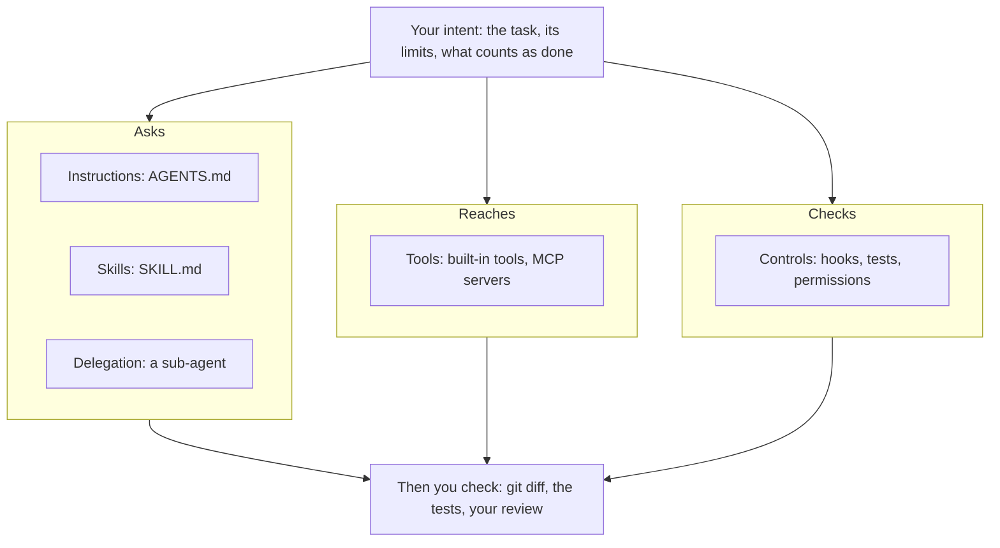
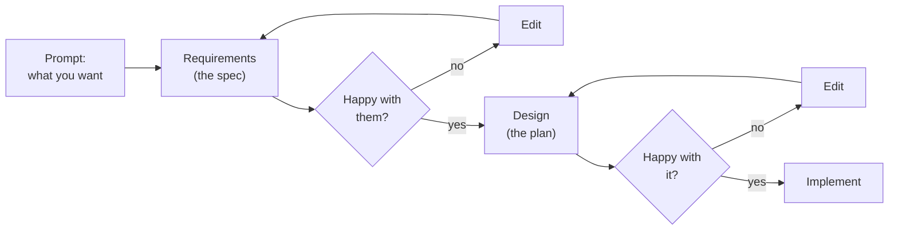

# Coding with AI Agents: the workshop, at your own pace

This page takes you through the *Coding with AI Agents* workshop on your own, in the same order as the session: six modules, three exercises, and a longer Spec Kit exercise to finish. Allow about three hours for the six modules and their exercises, and about 45 minutes more for the longer Spec Kit exercise, in as many sittings as you like. Training the model yourself (Module 5) is optional and takes hours more, mostly waiting. There is no facilitator, so every exercise has a way to check your work and an answer to compare with.

**The slides.** Open `docs/presentations/coding-with-ai-agents-2h.html` from your clone in a web browser (GitHub shows the file's source, not the slides). Move with the arrow keys, and press **N** to show each slide's notes: the "About this slide" part says what the speaker said. Each module below gives its slide numbers, which count only the slides shown by default (press **E** to show four hidden ones). The "Presenting" part of the notes was for the speaker; skip it.

**What you need:** Git and this repository, an AI coding agent, an empty practice folder, and `uv` with Spec Kit for Module 3. Module 0 sets them up.

**Tool facts checked on 19 October 2026.** Agent installers, plans and terms, Spec Kit's commands and Colab's limits change often. If a step no longer matches what you see, the tool's own documentation (linked at each step) wins; please tell us (see [Getting help](#getting-help)).

## The files you will use

The repository holds the whole project, but you only need a few files for this workshop. The full layout is in the README, "Repository layout".

| File or folder | What it is | Used in |
| :-- | :-- | :-- |
| [`docs/presentations/coding-with-ai-agents-2h.html`](presentations/coding-with-ai-agents-2h.html) | The session deck, with speaker notes (press N) | Every module |
| [`docs/setup.md`](setup.md) | What to install, by task, with the commands for each system | Module 0 |
| [`AGENTS.md`](../AGENTS.md) | The briefing for agents working in this repository: what the project is and its rules. Codex reads it directly and Claude Code through `CLAUDE.md`, which imports it; with other agents, check that it was loaded or ask the agent to read it | Modules 0 and 1 |
| [`.claude/settings.json`](../.claude/settings.json), [`.claude/hooks/require_green_tests.py`](../.claude/hooks/require_green_tests.py) | A Stop hook: it runs the app's tests (`flutter test`) and blocks the agent's first attempt to finish while they fail. It lets the agent stop if Flutter is not installed, if the tests still fail after it has blocked once, or if it is switched off (`RICE_PEST_STOP_HOOK=off`), so passing tests stay your responsibility | Module 2 |
| [`.claude/skills/refactor-safely/SKILL.md`](../.claude/skills/refactor-safely/SKILL.md) | A skill: reusable instructions for a behaviour-preserving refactor | Module 2 |
| [`.claude/agents/find-callers.md`](../.claude/agents/find-callers.md) | A read-only sub-agent that lists every use of a setting | Module 2 |
| [`.specify/memory/constitution.md`](../.specify/memory/constitution.md) | The project's Spec Kit constitution: the rules every spec and plan is checked against | Module 3 |
| [`specs/001-model-training/`](../specs/001-model-training/) | Spec, plan, research and tasks for the model, written after it was built | Modules 3 and 5 |
| [`specs/002-mobile-app/`](../specs/002-mobile-app/) | The same for the Android demo app, written after it was built | Modules 1 and 3 |
| [`specs/003-desktop-app/`](../specs/003-desktop-app/) | A Spec Kit spec, plan and tasks for a desktop app, written before any code: the answer to compare with in Module 3 | Module 3 |
| [`docs/presentations/demo-app-process.html`](presentations/demo-app-process.html) | Case study: how the app was built with an agent, including the prompts used | Modules 0, 1 and 5 |
| [`docs/presentations/model-training.html`](presentations/model-training.html) | Case study: how the model was trained, tested and judged | Module 5 |
| [`docs/presentations/harness-context-engineering.html`](presentations/harness-context-engineering.html) | Deep dive on agent harnesses and context engineering | Module 5 |
| [`notebooks/train_colab_r50v5.ipynb`](../notebooks/train_colab_r50v5.ipynb) | The training notebook for the demo model, generated by `tools/build_notebook.py` | Module 5 |
| [`src/rice_pest_detector/train.py`](../src/rice_pest_detector/train.py) | The training loop the notebook runs: checkpoints, resume, best epoch | Module 5 |
| [`docs/evaluation-record.md`](evaluation-record.md) | Every result, with its run, split and date | Module 5 |
| [`docs/model-cards/`](model-cards/) | One card per published model: what it is for, how it was trained, its limits | Module 5 |
| [`app/`](../app/) | The Flutter demo app: `lib/` is the code, `test/` its tests | Optional: run the demo app |
| [`docs/workshop-advanced/`](workshop-advanced/README.md), [`workshop/advanced/`](../workshop/advanced/) | The optional advanced track: its pages, and the verifier, starter files and regression patch it uses | Optional: the advanced track |

## Module 0. Introduction and set-up (slides 1–8, about 30 minutes)

Read slides 1–7: what the workshop covers, how it was made with AI, and why free tiers can train on what you type.

### Install what you need

Follow [setup.md](setup.md) for [Git](setup.md#git), [an AI coding agent](setup.md#an-ai-coding-agent) and [`uv` and Spec Kit](setup.md#uv-and-spec-kit), then clone this repository. You do not need to install Python, Flutter or the training tools: Exercise 1 runs its small Python tests through `uv`, which fetches a Python of its own if you have none. To see what you already have, [setup.md](setup.md#let-your-agent-check-what-is-installed) has a prompt that asks your agent to check, without installing anything.

### Set up your agent safely

1. **Check its terms.** Some agents exclude users under 18. Pick one whose terms allow you.
2. **Sign in once** and send it a test message.
3. **Switch training off.** Many free tiers may use what you type to improve their models. Find the data or training setting and turn it off.
4. **Know what not to paste.** Never paste personal or confidential material (company code, client data) or graded work. Everything in this workshop is safe to type.

Once your agent works, you can let it install the rest of what this workshop needs. Open it in the cloned `rice-pest-detector` folder and send:

> Read docs/workshop-setup.md and the "uv and Spec Kit" section of docs/setup.md. First tell me what is already installed and what is missing, and wait. Then make the practice folder and install only uv and Spec Kit, asking me before each command, and check that `specify --help` works. Do not change account, system or security settings, do not use admin rights, and do not install Flutter or Android tools.

Read its plan before you approve anything, and read each command before it runs: the `uv` installer downloads and runs a script from the internet. This is a small version of what the workshop is about. The repository's `AGENTS.md` repeats these limits for any agent that reads it.

### Make a practice folder

The exercises start from scratch, so keep them outside the cloned repository. Make the folder next to your clone, in the same parent folder; the optional advanced track's commands expect it there (`../agents-practice`):

```bash
mkdir agents-practice
cd agents-practice
git init
```

With Git you can see and undo what the agent did. `git status` lists changed and new files; `git diff` shows the changes to files Git already tracks; `git restore .` undoes those changes. Files the agent creates are untracked until you add them: `git diff` does not show them and `git restore .` does not remove them, so check `git status` and delete them yourself (`git clean -n` lists them, `git clean -f` removes them).

### Exercise 0: one prompt (slide 8, 5 minutes)

The demo app counts rice pests in a photo of a light trap. An agent drafted it; a person directed every step. See it: the screenshots in the demo-app case study (open `docs/presentations/demo-app-process.html` in a browser), or run it yourself ([Optional: run the demo app](#optional-run-the-demo-app-on-an-emulator)).

Now **write down the one prompt you think built this app**. If you have an agent, try it in your practice folder and look at what comes back. Keep what you wrote: Module 1 shows how the app really started.

## Module 1. Direct (slides 9–18, about 15 minutes)

Read slides 9–18: why the one-shot prompt fails, the agent loop, `AGENTS.md`, and how to read a plan and when to stop the agent.

**Compare your Exercise 0 prompt** with slide 15, "How the app actually started", and with the "Behind the scenes: prompts used" slides in the demo-app case study. The first prompt was a question about the tech stack, not a build request, and there were fourteen short prompts in all, each settling a decision.

**Check yourself:** which decisions did your prompt leave to the agent? Typical gaps are the platform (phone, web or desktop), where the photos come from, what the model is and where it runs, what counts as "done", and what the app must never do (here: give spray or treatment advice).

## Module 2. Context (slides 19–33, about 45 minutes)

Read slides 19–33: an agent is a model plus a *harness*, context windows and why long sessions cost more, then five ways to shape what an agent does (slide 28). Your intent goes in at the top; you check what comes out at the bottom:



Each one, with its example in this repository:

| Way | What it is | In this repository |
| :-- | :-- | :-- |
| Instructions | A file the agent reads when a session starts: what the project is, its rules | [`AGENTS.md`](../AGENTS.md) |
| Skills | A procedure the agent loads when a task matches its description | [`.claude/skills/refactor-safely/SKILL.md`](../.claude/skills/refactor-safely/SKILL.md), mirrored in `.agents/skills/` |
| Tools | What the agent can reach: its built-in tools, plus any MCP servers you connect | none added; MCP is on slide 30 |
| Controls | Hooks, tests and permissions: they run whatever the model decides | [`.claude/hooks/require_green_tests.py`](../.claude/hooks/require_green_tests.py), the Stop hook |
| Delegation | A narrower job given to a sub-agent with its own context window | [`.claude/agents/find-callers.md`](../.claude/agents/find-callers.md) |

The line that matters is on slide 31: **instructions and skills are requests, which the model may skip; controls check.** Exercise 1 shows both.

### Exercise 1: brief your agent and give it a skill (about 20 minutes)

You write the instructions and a skill for a small project, check that your agent read them, and judge what it did against them. Any agent works; the steps say where agents differ.

**Set up.** In your practice folder, make a project and give it two files. On Windows, keep the path short (for example `C:\practice\brief`): with a very long path, an agent's shell commands can fail with "The command line is too long".

```bash
mkdir brief
cd brief
git init
```

`prices.py`:

```python
def total_price(items):
    total = 0
    for name, price, qty in items:
        total = total + price * qty
    if total > 100:
        total = total - total * 0.1
    return round(total, 2)


def member_price(items):
    total = 0
    for name, price, qty in items:
        total = total + price * qty
    if total > 100:
        total = total - total * 0.1
    total = total - total * 0.05
    return round(total, 2)
```

`test_prices.py`:

```python
import unittest

from prices import member_price, total_price


class TestPrices(unittest.TestCase):
    def test_empty_order_costs_nothing(self):
        self.assertEqual(total_price([]), 0)

    def test_small_order_has_no_discount(self):
        self.assertEqual(total_price([("rice", 50, 1)]), 50)

    def test_exactly_100_has_no_discount(self):
        self.assertEqual(total_price([("rice", 100, 1)]), 100)

    def test_order_over_100_gets_10_percent_off(self):
        self.assertEqual(total_price([("rice", 60, 2)]), 108.0)

    def test_several_items_add_up_before_the_discount(self):
        self.assertEqual(total_price([("rice", 40, 2), ("salt", 30, 1)]), 99.0)

    def test_members_get_5_percent_off_a_small_order(self):
        self.assertEqual(member_price([("rice", 50, 1)]), 47.5)

    def test_members_get_5_percent_more_over_100(self):
        self.assertEqual(member_price([("rice", 60, 2)]), 102.6)


if __name__ == "__main__":
    unittest.main()
```

Run the tests with `uv run --no-project python -m unittest` and check that all seven pass (`uv` runs them on its own Python; if you already use Python, `python -m unittest` does the same). Then commit, so that `git diff` later shows only what the agent changed: first create a file `.gitignore` containing the line `__pycache__/` (the folder Python creates when it runs the tests), then `git add .` and `git commit -m "Starting point"`. If Git asks who you are, this is your first commit on this computer: run `git config --global user.name "Your Name"` and `git config --global user.email "you@example.com"` (any address works for local practice), then commit again.

1. **Write the instructions.** Create `AGENTS.md` in `brief/`:

   ```markdown
   # Rules for agents in this folder

   - Read a file before you change it.
   - Propose a plan and wait for my approval before you edit any file.
   - Do not install anything or add dependencies.
   - Run `uv run --no-project python -m unittest` before and after every change.
   - When you finish, say how you checked your work.
   ```

   Agents differ in which file they read. Recent Claude Code versions read `AGENTS.md` directly (checked with 2.1.310 and 2.1.312); older ones read only `CLAUDE.md`, and Gemini CLI reads `GEMINI.md` by default. Antigravity (`agy`, checked with 1.4.10) reads `AGENTS.md` and finds skills in `.agents/skills/`. If step 2 shows your agent missed the rules, create the file your agent does read (`CLAUDE.md` for Claude Code, `GEMINI.md` for Gemini CLI) with the single line `@AGENTS.md`, which imports the file, as this repository does.

2. **Check that it was read.** Start a fresh session in `brief/` and ask: *"What rules apply in this folder? Do not change anything."* If it cannot list your five rules, it did not load the file. If it gives no answer at all, check whether it tried a command you refused (such as listing the folder): that is not the same as missing the file, so ask again and approve the command, or add *"Answer from the rules you already have."* Ask it to read `AGENTS.md`, and note that your agent needs that.

3. **Add the skill.** Copy this repository's [`.agents/skills/refactor-safely/SKILL.md`](../.agents/skills/refactor-safely/SKILL.md) to `brief/.agents/skills/refactor-safely/SKILL.md`. Claude Code looks in `.claude/skills/` instead, so with Claude Code put the copy in `brief/.claude/skills/refactor-safely/`. The skill was written for this repository, so fit it to `brief/`: in its first step, replace the test commands (`flutter test` in `app/`, or `pytest`) with `uv run --no-project python -m unittest`, the command in your `AGENTS.md`; remove what does not exist in `brief/` (the `find-callers` sub-agent and the sentence about the Stop hook); widen the `description` line, which only mentions moving code between modules, so it also covers your task (for example, *Use when refactoring code without changing behaviour.*); keep the steps that still apply. A skill you borrow usually needs this kind of fitting. Commit the instructions and the skill.

4. **Ask for a refactor.** In a fresh session: *"`total_price` and `member_price` repeat the same code. Refactor `prices.py` so the repetition goes, without changing what either function returns."* Do not name the skill: see whether the agent finds it. Read its plan before you approve it. If the agent says it could not read files or run commands, its sandbox is blocking it: fix that first ([setup.md](setup.md#an-ai-coding-agent)), because a plan made without reading the code is not the behaviour you are testing. On Windows, Claude Code may ask to run the tests through PowerShell rather than Bash; the command is the same, so approve either.

5. **Judge the result.** Run `git status`, `git diff` and the tests yourself.

**Check yourself:** Did the agent propose a plan and wait? Did it run the tests before it changed anything, as both your `AGENTS.md` and the skill ask? Did it use the skill, and what is your evidence? Did it add or install anything? Name one rule it followed and one it skipped. What belongs in `AGENTS.md` and what in a skill?

<details>
<summary>What good answers look like</summary>

- **A good refactor** changes only `prices.py`, keeps both function names, and the seven tests still pass. One version moves the shared part into a helper:

  ```python
  def _discounted_subtotal(items):
      total = sum(price * qty for _name, price, qty in items)
      if total > 100:
          total = total - total * 0.1
      return total


  def total_price(items):
      return round(_discounted_subtotal(items), 2)


  def member_price(items):
      total = _discounted_subtotal(items)
      return round(total - total * 0.05, 2)
  ```

- **Passing tests are evidence, not proof.** A refactor that changes `total > 100` to `total >= 100` would wrongly discount an order worth exactly 100. `test_exactly_100_has_no_discount` catches that mistake; without it, the other six tests would still pass. Tests check edge cases only if someone wrote them, so read the diff as well.
- **Three kinds of evidence that the skill was used.** The agent *saying* it used the skill is its own report. Its activity log or trace *showing* it opened `SKILL.md` shows the skill was read. The diff and the tests *matching* the skill's steps show the work complied, which can also happen without the skill. Only the second shows the skill was loaded; only the third shows the result is right.
- **Loading differs by agent.** Most agents that support `AGENTS.md` read it when a session starts; older Claude Code versions read it only through a `CLAUDE.md` import. Some agents load a skill on their own when its description matches the task; others use it only when you name it. If yours did not, ask again with *"Use the refactor-safely skill"*. The Agent Skills format fixes the folder and the file, but leaves when a skill loads to each agent (see the glossary).
- **Requests and controls.** Your `AGENTS.md` and the skill both ask the agent to run the tests; nothing makes it do so. If it skipped them, that is slide 31. This repository backs the same rule with a control: the Stop hook in [`.claude/settings.json`](../.claude/settings.json) runs `flutter test` and blocks the agent's first attempt to finish while the tests fail. Give the rules that matter a test or a hook; check the rest yourself, with `git diff` and the tests.
- **Where things belong.** `AGENTS.md` holds the rules for every task in the folder; a skill holds the procedure for one kind of task, loaded only when needed.

</details>

**Going further (optional, about 10 minutes): the same briefing in a second harness.** Slide 20 says an agent is a model plus a harness. If you have a second agent, or the same agent's editor extension and its command-line tool ([setup.md, An AI coding agent](setup.md#an-ai-coding-agent)), undo the refactor (`git restore .`; check `git status` for new files), open `brief/` in the other harness, and repeat steps 2 and 4. Compare: did it find `AGENTS.md` and the skill without help? Did it plan first? Which commands did it ask permission for? The files were the same; whatever differs comes from the harness (slides 20–21), and even the same harness can answer the same prompt differently (slide 25).

## Module 3. Specify (slides 34–60, about 45 minutes)

**Spec-driven development (SDD)** means writing the spec first and having the agent build from it. Read slides 34–57: what a spec is, the anatomy of a real one, acceptance criteria, and ten SDD frameworks compared. They differ mainly in how long the spec stays current after the code is written, and in which of their rules are enforced by code rather than by prompts. The real specs are in this repository: [`.specify/memory/constitution.md`](../.specify/memory/constitution.md) and [`specs/`](../specs/), for the model (001), the phone app (002) and a desktop app (003).

The loop below is the core of SDD. You review each document before the agent moves on, and you edit it until you are happy with it; code comes last.



*Diagram adapted from IBM Technology, [Spec-Driven Development: AI Assisted Coding Explained](https://www.youtube.com/watch?v=mViFYTwWvcM) (28 Feb 2026).*

In Spec Kit, the steps map to its commands: `/speckit-specify` and `/speckit-clarify` write and settle the requirements (`spec.md`), `/speckit-plan` writes the design (`plan.md`), and `/speckit-tasks` and `/speckit-implement` build it. Exercise 2 stops at the first check: is the spec right?

### Exercise 2: Spec Kit (slides 58–59, 15 minutes)

In a new folder, on an idea of your own (your Exercise 0 app is fine):

```bash
specify init my-project --integration <your-agent-key>
```

Your agent's key is in Spec Kit's [integrations list](https://github.github.io/spec-kit/reference/integrations.html), for example `agy`, `claude` or `codex`. Open the new folder in your agent and type in its chat (Codex uses `$speckit-…` instead of `/speckit-…`):

```text
/speckit-constitution   the ground rules for the project
/speckit-specify        what you want and why, not how
/speckit-clarify        let it ask about what is ambiguous
```

Read the `spec.md` it wrote.

**Check yourself** (slide 60's debrief): is the spec ready to build from? Every requirement has a number where it needs one, and every question clarify asked has an answer. Name one question clarify asked that your Exercise 0 prompt never answered, one gap it missed, and one requirement that needed a number. Compare with the counting rule in [`specs/002-mobile-app/spec.md`](../specs/002-mobile-app/spec.md) (FR-002 and FR-006): a detection counts when its score is at or above the model's own threshold, an inclusive rule with a number (0.48 for the default model, from its manifest), not "when the model is confident".

### Going further: the whole Spec Kit flow on the desktop app (about 45 minutes)

Here you run every step of Spec Kit's [quickstart](https://github.github.io/spec-kit/quickstart.html), on a real feature: a desktop version of the demo app. You write the specification, the plan and the task list, but no code, then compare with ours in [`specs/003-desktop-app/`](../specs/003-desktop-app/). Any agent Spec Kit supports works; the examples use `claude`, and you replace it with your agent's key.

#### Step 1. Start from a clean branch

This repository already contains our Spec Kit run, so remove it on a branch of your own first. Your answers then cannot copy ours, and `main` keeps ours for the comparison at the end. Start with `git status` showing nothing to commit: `git rm` deletes the files from your folder as well as from Git, on this branch only. If anything goes wrong, `git switch main` brings every file back.

```bash
git switch -c my-speckit-run
git rm -r -q .specify specs .claude/skills/speckit-*
git commit -m "Start the Spec Kit exercise from scratch"
```

#### Step 2. Initialise Spec Kit in the repository

```bash
specify init --here --integration claude
```

Replace `claude` with your agent's key, for example `agy` or `codex`. `--here` sets Spec Kit up in the current folder instead of a new one; it asks before merging into a folder that is not empty (add `--force` to skip the question). It adds `.specify/` (templates, scripts, a blank constitution) and the `speckit-*` commands for your agent. Run `git status` to see exactly what it added. If it reformatted a file you already had, such as `.claude/settings.json`, `git diff` shows it and `git checkout -- <file>` puts it back.

#### Step 3. Run the commands in your agent

Open the repository folder in VS Code, open your agent's panel, and run each command on its own, reading what it wrote before you go on. Type the text after each command as its argument. In Codex, type `$speckit-…` instead of `/speckit-…`.

1. **Constitution**: the project's rules, which every later step is checked against.

   > /speckit-constitution Derive the principles from this repository's README, AGENTS.md and docs/inference-contract.md. Include: a teaching demo, not a field tool; one inference contract, checked with golden fixtures; test-first; thresholds and rules fixed before results; photos and data stay on the device; models verified before use; reuse shared files and choose the simplest design.

2. **Specify**: *what* to build and *why*, with no technology named.

   > /speckit-specify Build a desktop version of the Trap Pest Counter demo app for Windows, macOS and Linux, with the same features as the phone app: pick or drop a light-trap photo, count rice black bug and white stemborer with a model running on the computer, show review flags, keep past counts, and download, import, switch, delete and compare models. English and Filipino.

3. **Clarify** (optional, recommended): `/speckit-clarify`. The agent asks up to five questions about gaps in the spec. Answer them; each answer is written back into the spec.

4. **Plan**: *how*: the stack, the design and the checks against the constitution. We deliberately left the stack open:

   > /speckit-plan Compare two stacks in research and choose one: adding Windows, macOS and Linux targets to the existing Flutter app in app/, or a new Tauri 2 app with a Rust core and a TypeScript interface. The inference contract and its golden fixtures must keep working.

5. **Checklist** (optional): `/speckit-checklist` tests the spec's requirements for completeness and clarity.

6. **Tasks**: `/speckit-tasks` turns the plan into a numbered task list, grouped by user story, with tests before code.

7. **Analyze** (optional): `/speckit-analyze` is a read-only check that the spec, plan and tasks agree with each other and with the constitution.

Stop here. `/speckit-implement` and `/speckit-converge` would build the app, which is not part of this exercise.

#### Step 4. Compare with ours

First commit your run, so Git can compare it with `main`:

```bash
git add -A
git commit -m "My Spec Kit run"
```

Your files are under a folder such as `specs/001-desktop-app/` (Spec Kit picks the name): Spec Kit numbers features from 001, and your branch has no others. Ours is `specs/003-desktop-app/` on `main`, because `main` also holds the specs for the model (001) and the phone app (002). Compare them:

```bash
git diff main -- .specify/memory/constitution.md
git diff --no-index specs/001-desktop-app ../rice-pest-detector-main/specs/003-desktop-app
```

The second command needs a copy of `main` next to your clone (`git worktree add ../rice-pest-detector-main main`). Or simply open both on GitHub.

Questions to answer for yourself:

- Which stack did your plan choose, and which constitution principle decided it? Ours chose Flutter desktop: research R1 explains why, and the Tauri option is recorded as rejected.
- Did your Constitution Check pass, or did it need a Complexity Tracking entry?
- Which numbers did your spec put in its success criteria? Could you test each one?
- Did your agent write any requirement that names a technology? The spec should not.
- How many tasks did you get, and do the test tasks come before the code they test?

**Done when:** you have a constitution, a spec with no `[NEEDS CLARIFICATION]` left, a plan whose Constitution Check passes (or is justified), a task list, and your answers to the questions above.

**Clean up:** if you made the `rice-pest-detector-main` copy, remove it first with `git worktree remove ../rice-pest-detector-main` (Git cannot switch to `main` while that copy has it checked out). Then `git switch main` and `git branch -D my-speckit-run`. `-D` deletes the branch even if it was never merged, so first copy anything from it you want to keep. If Spec Kit or your agent created a feature branch of its own (for example `001-desktop-app`), delete it the same way.

## Module 4. Guard (slides 61–69, about 15 minutes)

Read slides 61–69: the agent acts with your permissions, prompt injection (including through files you ask it to review), the "lethal trifecta", secrets and sandboxes.

**Do it:** open your agent's settings and check the six safe defaults on slide 69 against them: approvals on; network off unless the task needs it; no secrets in the repository; edits scoped to the folders the task needs; every command reviewed before it runs; every new dependency checked. Which one would be hardest to keep in your own work, and what would make it easier?

## Module 5. Share (slides 70–82, about 20 minutes)

Read slides 70–82: how an agent built the real app, licences, the model behind it, the safety of what you ship and how teams use agents. Then go deeper:

- **Training the model:** `docs/presentations/model-training.html`, and [`specs/001-model-training/`](../specs/001-model-training/).
- **Building the app:** `docs/presentations/demo-app-process.html`, and [`specs/002-mobile-app/`](../specs/002-mobile-app/).
- **Agent harnesses and context engineering:** `docs/presentations/harness-context-engineering.html`.

**Safety of what you ship (slide 78).** Module 4 was about keeping the agent from harming you; this is about not harming other people with what you build. Six practices from the research literature, and how this project meets them, gaps included:

| Practice | What the literature says | This project |
| :-- | :-- | :-- |
| **1. Say what it is for, and what it is not for** | Ship each model with a model card: intended use, uses to avoid and results under the conditions that matter ([Mitchell et al., 2019](https://doi.org/10.1145/3287560.3287596)). Document the dataset as well ([Gebru et al., 2021](https://doi.org/10.1145/3458723)). | Done: the [model card](model-cards/r50-v5.md), the use notice, the "Demo" label in the app, and the data credited. |
| **2. Fix the rules before you see results** | Data leakage and reused test sets are a main cause of inflated machine-learning results ([Kapoor and Narayanan, 2023](https://doi.org/10.1016/j.patter.2023.100804)). Analyses chosen after seeing the data make the holdout unreliable ([Dwork et al., 2015](https://doi.org/10.1126/science.aaa9375)). REFORMS turns this into a 32-question reporting checklist ([Kapoor et al., 2024](https://doi.org/10.1126/sciadv.adk3452)). | Done: quality gates set before training. The test photos were used twice in the whole project, both recorded in the [evaluation record](evaluation-record.md). |
| **3. Expect it to fail on data it has not seen** | Models learn shortcuts that break outside their training conditions ([Geirhos et al., 2020](https://doi.org/10.1038/s42256-020-00257-z)). In agriculture, a plant-disease model scored 99.35% on its own held-out photos but just above 31% on photos taken under different conditions ([Mohanty et al., 2016](https://doi.org/10.3389/fpls.2016.01419)). | Stated, not solved: trained on light-trap photos only, with no check for unfamiliar inputs. Field validation on phone photos is still open. |
| **4. Keep a person in the loop, and design against over-trust** | People over-rely on automated aids; this complacency is predictable and has to be designed against ([Parasuraman and Manzey, 2010](https://doi.org/10.1177/0018720810376055)). | Partly done: the app flags photos with low scores or more than 30 insects for a person to review. The model card says the flag can miss doubtful counts on photos unlike the validation set. |
| **5. Manage risk over the whole life of the system** | Govern, map, measure and manage risk ([NIST AI RMF 1.0](https://doi.org/10.6028/NIST.AI.100-1)); test for production readiness ([Breck et al., 2017](https://doi.org/10.1109/BigData.2017.8258038)); audit internally at every stage ([Raji et al., 2020](https://doi.org/10.1145/3351095.3372873)). | Gaps: no monitoring after release and no independent review. The data-protection and wording reviews are still open. |
| **6. Treat text the system reads as untrusted** | Indirect prompt injection can take over applications built on large language models ([Greshake et al., 2023](https://doi.org/10.1145/3605764.3623985)). | Covered in Module 4 (slides 61–69). |

The open items in rows 3 and 5 are part of the lesson: they are why the app says "Demo".

**The five takeaways:** conduct the agent, do not one-shot it; write the spec before the code; put the rules that matter in hooks, tests and CI; treat text from outside as untrusted; an agent drafts, a person decides and stays accountable.

### Going further: train the model yourself (about 7 hours, mostly waiting)

The model-training case study shows how the detector was trained. Here you start a training run of the demo model's recipe (r50-v5) yourself, on a free Colab GPU, and compare your numbers with the published ones. You need a Google account with at least 20 GB free in Google Drive and a browser; nothing is installed on your computer ([setup.md, Training](setup.md#training)).

1. **Open the notebook.** Open [`notebooks/train_colab_r50v5.ipynb` in Colab](https://colab.research.google.com/github/kurtvalcorza/rice-pest-detector/blob/main/notebooks/train_colab_r50v5.ipynb) (the badge in the README, "Training on Colab", does the same).
2. **Choose a GPU.** Runtime → Change runtime type → **T4 GPU**. The notebook stops early if no GPU is attached.
3. **Leave the settings as they are.** The notebook runs the published recipe unchanged: 40 epochs, which took 6.2 hours on a T4 for the published run. Keep the browser tab open; a free Colab session can end before that, and Run all then picks up where it stopped (step 4).

   *Short on time?* The published run's best checkpoint came at epoch 1 (counting from 0). You can change `epochs=40` to a smaller number in the training cell (the second to last, the one that contains `epochs=40`), but then it is your own experiment: the learning-rate schedule spreads over the epochs you choose, so your numbers will differ from the published run's.
4. **Run it.** Runtime → Run all, and accept the Google Drive prompt. The notebook installs its packages, downloads the dataset from Zenodo and checks every image (about 20 minutes), then trains (about 9 minutes per epoch on a T4). If Colab disconnects, choose Run all again: training resumes from Drive.
5. **The last cell stops on purpose.** It refuses to evaluate on the test photos (`THRESHOLD = None`): in this project the test split is looked at only under rules written down in advance (constitution Principle IV). The run is finished when the training cell prints the path of `best.pt`.
6. **Release the GPU.** Runtime → Disconnect and delete runtime, so the run stops using your Colab quota.

#### How the notebook is built, and why

A free Colab GPU can disappear mid-run, and a training script copied by hand drifts from the code it came from. Each choice below answers one of those problems. It is also the kind of thing to write into a spec before an agent builds it, because an agent will not think of it unless asked.

- **It survives an interrupted session.** After every epoch, the notebook saves `last.pt` to your Google Drive. It holds the model, the optimiser, the learning-rate schedule, the epoch number, the best score so far and the random-number state. When you choose Run all again after a disconnect, training picks up at the next epoch as if nothing had happened, and rows from the interrupted epoch are dropped from `history.jsonl` so none are counted twice.
- **It will not resume the wrong run.** `last.pt` also stores a fingerprint of the experiment: the training settings and the checksums of the data split and validation labels. If they differ from the notebook's (for example, you changed `epochs` after an interruption), it stops with "run directory holds a different experiment" instead of quietly mixing two runs. Start a new run folder instead.
- **Its checkpoints are never half-written.** `last.pt` and `best.pt` are written to a temporary file and then renamed, so a disconnect in the middle of a save cannot leave a corrupt checkpoint. The history gains one line per epoch; a line cut off by a disconnect is dropped with a warning when the run resumes.
- **It keeps the best epoch, chosen on validation.** `best.pt` holds the weights from the epoch with the highest validation species mAP50, with its score, epoch and fingerprint. The test photos play no part in choosing it.
- **It is generated, not hand-edited.** `tools/build_notebook.py` writes the notebook from the package's own source, and `--check` fails if the committed notebook differs from a fresh build, so the notebook and the tested code cannot drift apart.
- **One upload runs everything.** The notebook writes the package's modules to disk and carries the split files inside itself, so nothing else needs uploading. It pins the base model's revision and the training library's version, and logs the environment to Drive.
- **It checks its inputs and its hardware.** It stops if no GPU is attached, warns if Drive has less than 20 GB free, and checks the downloaded dataset's size and checksums, and every image against the split manifest, before training.
- **It does not crash on a bad step.** Losses are computed in full precision even when training uses half precision, and an update whose gradient is not a finite number is skipped and counted in the history rather than corrupting the model.

The reasons, with the alternatives that were rejected, are in [`specs/001-model-training/research.md`](../specs/001-model-training/research.md) (R11, R12 and R14), and the README lists the guarantees under "What the training loop guarantees".

**Check yourself.** In Google Drive, open `rice-pest-detector/run-r50v5/best.json`: it holds your best validation species mAP50 (`map50_species`) and the epoch it came from; `history.jsonl` beside it has one line per epoch. Compare with the published r50-v5 run in [`docs/evaluation-record.md`](evaluation-record.md) ("Wave 2"): 0.937 at epoch 1. Then answer: why is the threshold for counting chosen on validation photos and never on test photos? (The model-training case study and [`specs/001-model-training/research.md`](../specs/001-model-training/research.md), R6, explain it.)

#### Exercise: reverse-engineer the notebook with your agent (about 20 minutes, no GPU needed)

Agents are good at reading code you did not write, and turning it into a spec is how [`specs/001-model-training/`](../specs/001-model-training/) and [`specs/002-mobile-app/`](../specs/002-mobile-app/) were made. You can do this before, during or instead of a training run. Open your agent in the cloned repository and send:

> Reverse-engineer notebooks/train_colab_r50v5.ipynb. Do not run it and do not change any file. Five cells hold the data files as long encoded text: say what they contain, but do not read their contents. 1) List the cells in order, one line each on what it does. 2) Find out how the notebook is made: which script generates it and from which source files. 3) Explain what happens if Colab disconnects in the middle of training, citing the code. 4) Write a short spec of the notebook: what it must do and why, as numbered requirements I could test. Then wait for me.

**Check its work** against what the repository says:

- **The cells:** the README, "Training notebooks", draws them, from mounting Drive to the locked test cell.
- **How it is made:** `tools/build_notebook.py`, with `--check` (README, "Training on Colab"). If your agent says the notebook was written by hand, it is wrong.
- **Disconnects:** "How the notebook is built, and why" above, and `load_checkpoint` and `check_experiment` in `src/rice_pest_detector/train.py`.
- **Its spec:** compare with requirements FR-007 to FR-009 in [`specs/001-model-training/spec.md`](../specs/001-model-training/spec.md) and with [`contracts/notebook-generator.md`](../specs/001-model-training/contracts/notebook-generator.md). What did your agent miss, and what did it invent?

This is Module 2 and Module 3 together: watch how much of its context window the notebook uses (the five data cells are encoded text, two of them about 2 MB each, which is why the prompt tells it to skip them), and notice that a spec reverse-engineered from code records what the code does, not whether it was the right thing to build.

To start runs from a terminal or let an agent drive Colab, see [setup.md, Colab CLI](setup.md#colab-cli-optional) and [MCP](setup.md#let-your-agent-work-with-colab-and-kaggle-mcp).

**After training.** Choosing a counting threshold, exporting to ONNX and checking parity with PyTorch run on your computer with the Python tools ([setup.md, Python tools and tests](setup.md#python-tools-and-tests)); the steps are in the README, "Evaluation", "Export to ONNX and parity" and "Choosing a demo threshold". An exported model can be imported into the demo app from Settings, where it is marked "Demo model, not validated".

### Going further: the advanced track (optional)

After the six modules, an [optional advanced track](workshop-advanced/README.md) takes you from using a coding agent to engineering a controlled agent workflow on this repository's real inference code. [Module 6, "Engineer: protect the inference contract"](workshop-advanced/module-6-engineer.md) (about 45–60 minutes) is ready: you break the detector's preprocessing on purpose in a throwaway worktree, see which controls notice, and build a small verifier that says PASS only when the tests really ran and passed. Modules 7 (orchestrate) and 8 (automate) will follow; the whole track will take about 2.75–3.75 hours. It needs only Git, `uv` and your agent from Module 0, and changes nothing in the core course.

## Optional: run the demo app on an emulator

Not needed for the session. Install Flutter, Android Studio and an emulator first: [setup.md, Demo app](setup.md#demo-app-optional) (allow one to two hours the first time). Then start the emulator and, from the repository's `app/` folder:

```bash
flutter run --no-enable-impeller -d emulator-5554
```

The `--no-enable-impeller` flag avoids a hang on emulators without a graphics card. Or let a script do the starting, waiting and running: `.\tools\run_emulator.ps1` (Windows PowerShell) or `tools/run_emulator.sh` (macOS, Linux). It finds the Android SDK (`ANDROID_HOME`) and Flutter (on `PATH`; the PowerShell script also checks `FLUTTER_ROOT`), starts the first emulator (or `-Avd <name>` / `--avd <name>`), waits for it to boot and runs the app. Add `-Fresh` / `--fresh` to clear the app's data first, so you can try the model download from the start. More detail, including device tests, is in the README, "Demo app (Android)".

**The model.** The trained weights are not part of this repository; they are published on [Kaggle](https://www.kaggle.com/models/kurtvalcorza/rice-pest-detector). A fresh install opens with "No model is installed yet", and counting is off until the model is downloaded. The app's home screen offers **Download the model**: the app fetches r50-v5 (about 172 MB) from Kaggle, checks its size and SHA-256 and then counts, with the notice "Demo: real model weights … not validated in the field".

## If something does not work

- **An install fails** (`uv`, `specify`, Git, Python): see [setup.md, If something does not work](setup.md#if-something-does-not-work).
- **No agent, or under 18 and none allowed:** you can still read the slides, do Exercise 0 on paper, and read the plans and specs in this repository; or pair with someone who has an agent and read every action before it is approved.
- **A work or school laptop blocks installs:** ask your IT team, or use a personal machine.

## Getting help

**Ask your agent first.** Open it in the cloned `rice-pest-detector` folder and send, for example:

> I'm following docs/workshop-setup.md, Module 3, Exercise 2. This command failed: `<command>`, with this output: `<error>`. Read that step and docs/setup.md, explain the likely cause, and propose a fix. Check the tool's own documentation instead of relying on memory, and do not run anything until I approve it.

Read its explanation before you approve any command, especially an install or a settings change: an agent can be confidently wrong about a tool that changed after its training (the knowledge-cutoff slide in Module 2). Remove keys, tokens and personal details from anything you paste.

If your agent cannot solve it, ask in the open, where the answer helps the next person too, and say what the agent tried:

- **A question about the workshop, an exercise or a step on this page:** post it in the [Q&A category of Discussions](https://github.com/kurtvalcorza/rice-pest-detector/discussions/categories/q-a). Search there first; someone may have asked already.
- **Something in the repository is broken or wrong** (a command fails, a link is dead, a test fails): open an issue with the **Bug report** form, as [CONTRIBUTING.md](../CONTRIBUTING.md) describes.
- **A security problem:** do not post it in public; see [SECURITY.md](../SECURITY.md).

Never post personal or confidential material, keys or tokens, even when asking for help.

## Before you go: a short survey (slide 83, optional)

To train and share the model in this course you used several separate services: GPU time on Colab or Kaggle, the dataset on Zenodo, the published models on Kaggle and the code on GitHub.

We are studying whether a national AI-as-a-Service platform could bring these together for researchers, developers and students in the Philippines. As proposed, it would offer a searchable repository of documented datasets and models, with hosted inference and controlled fine-tuning planned. It is a proposal, not yet an available service: capacity, support and pricing are not decided.

If you would like to take part, the survey is at [aiaas-market-study-st8x.vercel.app](https://aiaas-market-study-st8x.vercel.app/).

- It takes about 12 minutes.
- Taking part is voluntary, and a low rating is as useful as a high one.
- Read the consent notice on the first page before you start.
- Do not enter passwords, access keys or other people's personal data.

## Glossary

| Term | Meaning here |
| :-- | :-- |
| Agent | An AI model that can act: read files, run commands and edit code, in a loop, with your approval. *Agent = model + harness* (Module 2). |
| Harness | The program around the model that gives it tools, context and permissions: the extension or command-line tool you install. |
| Context window | Everything the model can see at once: your messages, the files it read, the tool output. It is limited, and the model remembers nothing between sessions unless it is written down. |
| `AGENTS.md` | A file in a repository that briefs coding agents: what the project is and the rules to follow. Agents that support it read it; check, rather than assume, that yours did. |
| Skill, hook, sub-agent | Ways to extend an agent: a skill is reusable instructions, a hook runs a check automatically (this repository's Stop hook runs the tests), a sub-agent is a helper with a narrower job. |
| MCP | Model Context Protocol: a standard way to connect an agent to outside tools and data, such as Colab or Kaggle. |
| Agent Skills | An open format for skills: a folder holding a `SKILL.md` file, whose name and description tell the agent when to load it. It fixes the folder and the file, not when a skill loads; each agent decides that. |
| ACP | Agent Client Protocol: a community standard for connecting a code editor to a coding agent, so one editor can work with several agents. |
| A2A | Agent2Agent protocol: a standard for agents in different systems to send each other tasks and messages. Not the same as a sub-agent, which runs inside one agent's harness. |
| One-shot prompt | Asking for a whole result in one prompt, instead of planning and building step by step. |
| Prompt injection | Text the agent reads (in a file, web page or issue) that tries to give it instructions you did not give. |
| Spec | A written description of what to build and why, with requirements you can test, before any code. |
| Constitution | In Spec Kit, the project's ground rules; every spec, plan and task list is checked against it. |
| SDD (spec-driven development) | Writing the spec first and having the agent build from it. Spec Kit is one SDD toolkit; Module 3 compares ten. |
| Spec Kit | GitHub's open-source toolkit for spec-driven development: constitution, specify, clarify, plan, tasks, implement. |
| Validation and test photos | Photos held back from training. Validation photos are used to choose the model and the threshold; test photos are kept for a final, rule-bound check. |
| Threshold | The score at or above which a detection is counted: 0.48 for the default model. |
| mAP50 | Mean average precision at 50% box overlap: how well the detector finds and ranks the insects, from 0 to 1. |
| Count accuracy | The share of photos where both species are counted close enough: within 1 when the true count is under 10, otherwise within 10%. The project's headline measure. |
| ONNX | A portable file format for trained models, used to run the model in the app and on a laptop. |
| GPU, T4 | A graphics processor, which trains and runs models far faster than a CPU. The T4 is the GPU model Colab and Kaggle offer on their free tiers; the training notebooks expect one. |
| CLI | Command-line interface: a program you run by typing commands in a terminal, such as `git`, `specify`, `claude` or `colab`. |
| CI | Continuous integration: checks that run automatically on every change pushed to the repository. Here, GitHub runs the tests and the `--check` commands. |
| SHA-256 | A fingerprint of a file's exact bytes. If even one byte differs, the fingerprint differs, so it proves a download or a model file is the expected one. |
